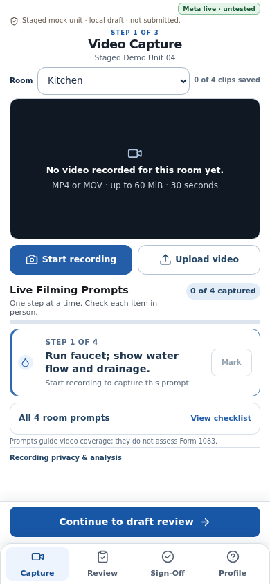
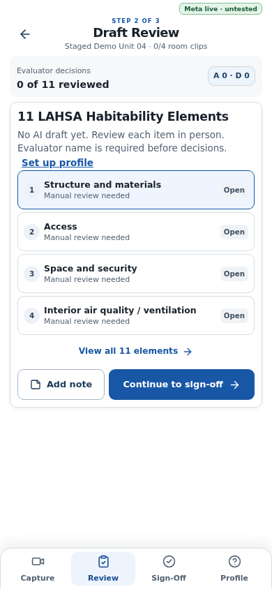
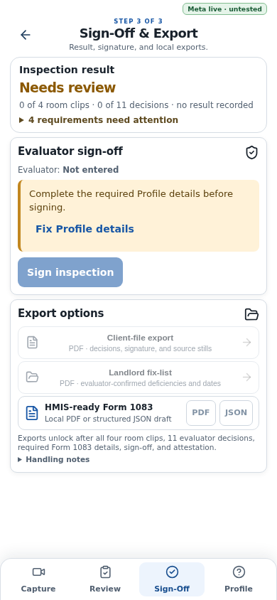

# Walkthrough Kit

**A human-led, AI-assisted habitability walkthrough for housing navigators.**

Walkthrough Kit helps housing navigators and case managers capture a staged unit walkthrough, review evidence-linked AI observations, and prepare local files for a manual habitability-inspection workflow.

After a household has spent a long time waiting for housing assistance, finding an apartment can still mean repeated calls, visits, and paperwork. A unit may turn out not to meet the applicable requirements after a case manager and household have already invested scarce time. The walkthrough itself can also fall to staff who are carrying high caseloads and may not inspect units every day. Walkthrough Kit is designed to make that work easier to follow and review while keeping the evaluator responsible for every inspection decision.

> **Current scope:** This repository implements a guided Form 1083 walkthrough and local exports. Pre-visit address screening and SAM.gov lookups are a proposed direction only; they are not implemented or verified here. No measured time savings, voucher eligibility result, or provider acceptance is claimed.

## What it does

- Guides a worker through kitchen, bathroom, bedroom/living area, and hallway video capture.
- Uses Meta SAM 3.1 to identify candidate moments and Meta Muse Spark to draft observations from actual video stills.
- Keeps AI observations separate from the worker’s inspection decisions. The worker reviews evidence, completes required checks, signs, and controls the final result.
- Prepares local client-file and landlord-fix-list PDFs, a filled copy of the official LAHSA FY 2022–23 Form 1083 with evidence pages, and companion JSON.
- Keeps clips, decisions, and signatures on the device. A live analysis request transfers the selected clip to the configured provider; provider retention follows current provider terms.

AI output is a draft, not an inspection verdict. The app does not perform an HQS inspection, submit to HMIS, deliver files to a landlord, or claim that a recipient accepts its exports. Staged-demo identity and unit-address fields remain blank, so those exports are not case-ready.

## Screens

The screenshots show the empty/staged interface. They do not depict recorded room evidence, completed inspections, or provider results.

| Capture | Review | Sign-off |
|---|---|---|
|  |  |  |

More phone and desktop captures and the visual QA notes are in [design-qa.md](design-qa.md).

## Run locally

**Runtime:** Node.js 22.

```sh
npm ci
cp .env.example .env.local
npm run dev
```

For local development, use `APP_ANALYSIS_MODE=fixture`; fixture responses are synthetic and must not be presented as live provider output. Live analysis requires a server-side `META_API_KEY` (or the documented `MODEL_API_KEY` alias), `APP_ANALYSIS_MODE=live`, and the documented FFmpeg runtime. Never expose provider keys through `NEXT_PUBLIC_*` variables or commit them. See [development setup](docs/DEVELOPMENT.md) for environment details.

## Verification status

The codebase contains the guided capture, review, sign-off, provider routes, and local export flow. Recorded checks and live evaluation evidence are separate: a fixture or CI pass does not prove provider quality or field readiness. The scored two-room evaluation is documented separately from the still-open authored single-clip gate. Physical-device checks and recipient acceptance are also open.

Room capture is capped at 30 seconds for kitchen, bathroom, and bedroom/living room, and 15 seconds for hallway. The front door and lock are captured in the hallway. Staged footage must pass the live evaluation gate before AI analysis quality is called reliable.

See [current project status](docs/STATUS.md) for the evidence-based snapshot and [the video evaluation record](docs/evaluation/video-clip-gate.md) for the precise gate distinction.

## Hackathon and portfolio story

The project addresses the work around a housing walkthrough: households may have waited a long time for assistance, while case managers have limited time to identify a suitable unit and document its condition. The companion uses Meta SAM and Muse to help organize video evidence, then keeps the human evaluator in control of findings and sign-off.

An earlier pre-inspection screening idea—checking an address and relevant SAM.gov records before arranging a visit—is **not part of the current app**. Its purpose, data sources, eligibility rules, and reliability need to be defined before it can be described as a capability. The project has no measured evidence yet that it saves staff time or prevents wasted visits.

Read the [hackathon project narrative](docs/HACKATHON.md) for the problem, approach, Meta tooling, demo boundaries, and open questions.

## Documentation

- [Project overview and problem statement](docs/PROJECT_OVERVIEW.md)
- [Architecture and data boundaries](docs/ARCHITECTURE.md)
- [Local development and configuration](docs/DEVELOPMENT.md)
- [Privacy, safety, and limitations](docs/PRIVACY_AND_SAFETY.md)
- [Hackathon narrative](docs/HACKATHON.md)
- [Documentation index](docs/README.md)
- [Product brief](docs/PRODUCT_BRIEF.md) · [Decisions](docs/DECISIONS.md) · [Form 1083 integration contract](docs/integration/FORM_1083_MAPPING.md)

## Project name

The product name is **Walkthrough Kit**. The GitHub repository URL currently uses the `meta-inspector` slug. The `walkthroughkit.com` domain is being purchased; do not treat it as a live public site until registration and deployment are confirmed.

## License and bundled materials

Project-authored code is licensed under the MIT License. The official LAHSA form, bundled fonts, and generated voice assets have separate provenance or terms; see [third-party notices](THIRD_PARTY_NOTICES.md). Do not assume the project license changes their terms.
