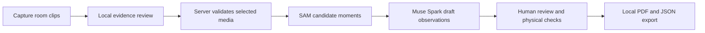

# Walkthrough Kit

[](https://github.com/jd-chiles/meta-inspector/actions/workflows/ci.yml)

**A human-led, AI-assisted walkthrough prototype for housing navigators.**

Walkthrough Kit helps a worker capture a staged unit walkthrough, organize room video as reviewable evidence, and prepare local inspection files. AI can suggest what is visible; a human evaluator remains responsible for physical checks, decisions, and sign-off.

> **Prototype boundary:** This is a hackathon and portfolio project. It does not conduct an HQS inspection, make eligibility decisions, submit to HMIS, deliver files to landlords, or establish agency acceptance. The repository reports no measured time savings, avoided visits, inspection accuracy, or housing outcomes.

## See it

These screenshots show the empty staged interface, not completed inspections or provider-generated results.

| Capture | Evidence review | Evaluator sign-off |
|---|---|---|
|  |  |  |

For a reproducible presentation, see the [4-minute demo walkthrough](docs/DEMO.md). The [portfolio case study](docs/CASE_STUDY.md) explains the product decisions and technical approach.

## What it does

- Guides capture across kitchen, bathroom, bedroom/living area, and hallway.
- Uses Meta SAM 3.1 to identify candidate moments and Meta Muse Spark to draft observations tied to server-derived video stills.
- Keeps AI observations separate from required in-person checks and evaluator decisions.
- Preserves evidence identity so stale or mismatched analysis cannot silently attach to changed media.
- Generates local PDF and JSON artifacts for manual handling, including a copy of the LAHSA FY 2022–23 Form 1083 and supporting evidence pages.

Capture limits are 30 seconds for the kitchen, bathroom, and bedroom/living area, and 15 seconds for the hallway. The front door and lock are included in the hallway walkthrough.

## How it works



The browser stores sessions locally. Live analysis runs only after an explicit request and sends selected media to configured providers; credentials and provider calls remain server-side. Fixture mode is synthetic and does not require provider credentials.

## Run locally

**Requirements:** Node.js 22 and npm.

```sh
npm ci
cp .env.example .env.local
npm run dev
```

Keep `APP_ANALYSIS_MODE=fixture` for local development. Fixture output is synthetic. Live analysis requires server-side provider credentials, can incur provider charges, and transfers selected media to configured providers. Use only rights-cleared staged/mock-unit media. See [development setup](docs/DEVELOPMENT.md) and [privacy and safety](docs/PRIVACY_AND_SAFETY.md).

## Verification

CI runs the public Markdown/link check, lint, TypeScript check, unit/API-boundary tests, production build, and browser acceptance tests in fixture mode. The credentialed live-provider smoke test is separate and is not run by normal CI.

```sh
node scripts/verify-docs.mjs
npm run lint
npm run typecheck
npm run test:unit
npm run build
npm run test:e2e
```

A passing check supports only the code paths it exercises. It does not establish live model quality, physical-device compatibility, recipient acceptance, or field effectiveness. See the [evaluation protocol](docs/evaluation/protocol.md).

## Documentation

Start with the [documentation index](docs/README.md), or go directly to:

- [Portfolio case study](docs/CASE_STUDY.md)
- [Demo walkthrough](docs/DEMO.md)
- [Project overview and scope](docs/PROJECT_OVERVIEW.md)
- [Architecture and trust boundaries](docs/ARCHITECTURE.md)
- [Form 1083 workflow and integration limits](docs/integration/FORM_1083_MAPPING.md)
- [Analysis API contract](docs/integration/ANALYZE_CONTRACT.md)
- [Privacy, safety, and limitations](docs/PRIVACY_AND_SAFETY.md)
- [Evaluation protocol](docs/evaluation/protocol.md)
- [Third-party notices](THIRD_PARTY_NOTICES.md)
- [Contributing](CONTRIBUTING.md)

## Project identity and license

The product is named **Walkthrough Kit**; the repository keeps the `meta-inspector` URL slug. Project-authored code is licensed under MIT. Bundled forms, fonts, generated audio, and dependencies have separate terms; see [third-party notices](THIRD_PARTY_NOTICES.md).
