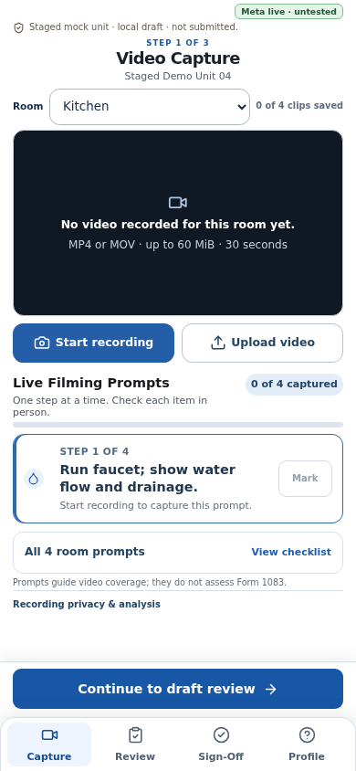
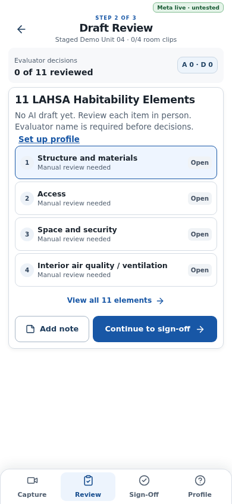
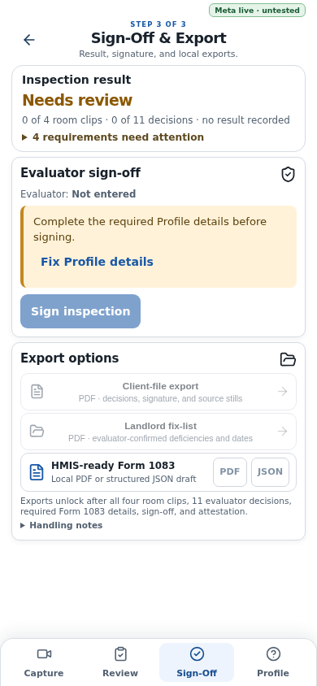

# Walkthrough Kit

**A mobile walkthrough tool that helps housing navigators turn room video into an inspection packet they can review and sign.** Built for the Meta Muse hackathon and developed in the `meta-inspector` repository.

[Watch the hackathon demo](https://youtube.com/shorts/Hd3KRB_YYC4) · [Read the case study](docs/CASE_STUDY.md) · [Run it locally](#try-it-locally)

Housing navigators need to capture what they saw, record checks that require an in-person visit, and assemble the supporting paperwork. Walkthrough Kit puts those steps in one mobile workflow.

| Step | What the navigator does |
|---|---|
| **Capture** | Record or upload short clips for the kitchen, bathroom, bedroom or living area, and hallway. |
| **Review** | In live mode, Meta SAM 3.1 finds candidate moments in the footage and Muse Spark drafts observations linked to stills. The evaluator reviews the evidence, records decisions, and completes physical checks. |
| **Sign and export** | After review, the evaluator signs and can export a draft packet with PDF and JSON files for manual handling. The modeled checklist uses LAHSA Form 1083, FY 2022–23. |

## Screens

The screenshots show the staged interface. The video shows the hackathon walkthrough.

| Capture | Review | Sign-off |
|---|---|---|
|  |  |  |

## Try it locally

Use **Node.js 22** and npm. Run these commands from the repository root in PowerShell on Windows.

```powershell
npm.cmd ci
$env:APP_ANALYSIS_MODE = 'fixture'
npm.cmd run dev
```

In Bash or Zsh, run `npm ci`, then `APP_ANALYSIS_MODE=fixture npm run dev`.

1. Open [http://localhost:3000](http://localhost:3000) to start the walkthrough.
2. Select **Start inspection** and **Start guided inspection**. Follow the setup prompts to the first filming screen, then use the home icon to exit the guided tour.
3. From the home screen, select **Kitchen** and upload the [bundled MP4 test pattern](tests/fixtures/synthetic-h264-test-pattern.mp4) to try clip capture and playback.
4. Open **Review**, select a checklist item, and save a staged evaluator decision. The **Sign-off** flow follows the required checklist decisions.

This setup runs without model credentials. The test-pattern video is synthetic, and fixture mode does not run SAM or Muse Spark inference on it. See [development setup](docs/DEVELOPMENT.md) for live configuration and [privacy and safety](docs/PRIVACY_AND_SAFETY.md) for media requirements.

## What the project demonstrates

In documented live tests, the staged kitchen and bathroom runs returned evidence-linked drafts. Review found an overstated observation and some loose labels, and the broader lock and detector coverage remained unverified. The evaluator controls every checklist decision and sign-off. See the [staged-video evaluation record](docs/evaluation/video-clip-gate.md) for the method and findings.

The prototype is for staged walkthroughs and manual exports. Field accuracy, staff time savings, and recipient acceptance remain unmeasured. See the [project scope](docs/PROJECT_OVERVIEW.md) and [documentation index](docs/README.md) for the implementation and evaluation details.

## License

Project-authored code is licensed under MIT. See [third-party notices](THIRD_PARTY_NOTICES.md) for bundled forms, fonts, audio, and dependencies.
