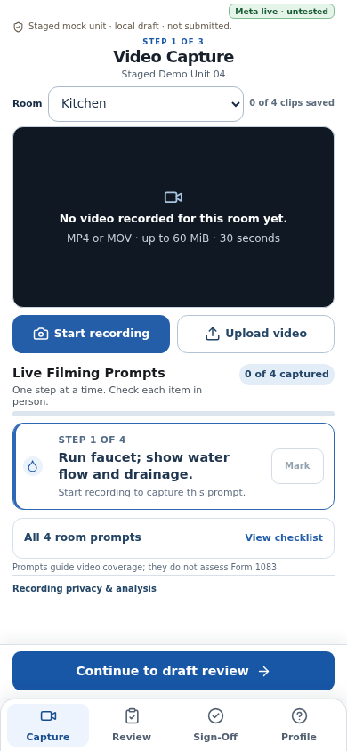
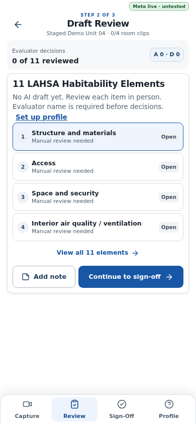
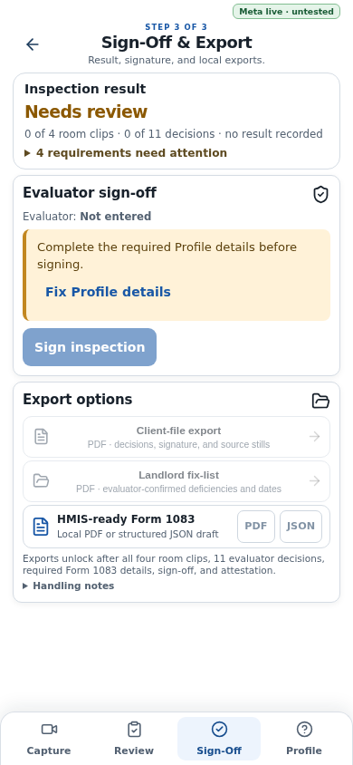

# Interface design notes

The interface follows a mobile-first walkthrough: capture, evidence review, evaluator sign-off, and local export. The supplied reference screens informed the visual hierarchy, while the implementation avoids inventing recorded evidence or completed inspection decisions in the empty staged experience.

## Screenshots

| Capture | Review | Sign-off |
|---|---|---|
|  |  |  |

The screenshots show the staged interface only. They do not represent provider output or a completed inspection. The browser and device constraints are documented in the [development guide](docs/DEVELOPMENT.md).
