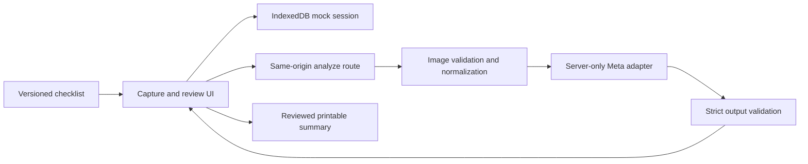

# Design

## Proposed architecture

Use Next.js, TypeScript, React and CSS modules; Zod; IndexedDB; Vitest; Playwright. TASK-002 pins compatible stable dependency versions and a lockfile after consulting official documentation. This documentation change installs no app dependencies.

## Proposed paths

| Path | Responsibility |
|---|---|
| src/app/ | Shell, routes, layout |
| src/features/walkthrough/ | Capture, review, summary |
| src/domain/ | Catalog/evidence schemas, reducer, review rules |
| src/data/catalog.demo.json | Clearly illustrative catalog |
| src/storage/ | IndexedDB versioning/deletion |
| src/server/meta/ | Provider adapter/config/validation/timeout |
| src/server/media/ | Decode limits and normalization |
| src/export/ | Safe printable summary |
| fixtures/ | Rights-cleared media and response fixtures |
| tests/unit/, tests/e2e/ | Boundary/state/API/browser tests |

## Contracts and ownership

Catalog has schemaVersion, catalogId, version, demo/provider-confirmed mode, source-confirmation metadata and 3–4 items. Items have stable ID, label, capture guidance and required manual checks. Only confirmed items have exact Form 1083 references.

Session owns ID, schema version, timestamps, catalog snapshot and item records. Snapshot prevents catalog changes from reinterpreting old evidence. Item record owns media reference/digest/time, attempt, original model draft, worker revisions, disposition and manual-check responses.

Strict AnalysisDraft: observation (1–600 characters); visibleEvidence, unknowns, suggestedManualChecks (each 0–5 strings, 200 characters per string). No verdict/confidence field. Display union of catalog checks and model suggestions; AI cannot clear required checks.

Application-generated AnalysisEnvelope: analysisId, sessionId, itemId, catalogVersion, mediaId, mediaHash, model, mode, requestId, latencyMs, draft. IDs from model text are never trusted.

The success response also supplies normalizedMedia (image/jpeg bytes encoded as base64, width, height and digest), bounded to 2 MiB encoded image bytes. Client stores those canonical bytes with the server digest rather than attaching the digest to an older raw file. Raw capture previews are transient. Before persistence, client canvas re-encoding strips metadata; the server remains the authoritative validator/normalizer and returns its canonical representation. A response replaces local media and creates the draft in one transaction only if the attempt still matches. A changed canonical digest invalidates any earlier review. Persisted recovery covers normalized evidence; closing during a transient, unconfirmed capture may require recapture and the UI must say so.

## API and configuration

POST /api/analyze accepts multipart image plus sessionId, itemId, catalogVersion, mediaId, analysisId. Resolve guidance from server catalog and reject version mismatch. Normalize bytes and compute digest before provider call. Commit response only if current client attempt matches.

Errors: {error: {code, message, retryable}, analysisId}. Codes/status: SETUP_REQUIRED/503; INVALID_MEDIA/400,413,415,422 as applicable; ITEM_MISMATCH/409; REQUEST_IN_PROGRESS/409; PROVIDER_RATE_LIMIT/429; PROVIDER_TIMEOUT/504; PROVIDER_UNAVAILABLE/502; INVALID_MODEL_OUTPUT/502. Retryable enables a user action, never automatic billed retries.

Environment: META_API_KEY server-only; META_MODEL; META_API_BASE_URL checked against an official allowlist; APP_ANALYSIS_MODE=live|fixture. No NEXT_PUBLIC secrets. Exact Meta URL/payload/model ID are established in TASK-001 using official docs. Do not substitute OpenAI credentials or guess provider compatibility.

## State, storage and races

empty → captured → analyzing → draft → reviewed/rejected; error retains source photo. Replacement/item change increments revision and resets review. Manual-check completion is separate; accept cannot imply a physical test.

Use AbortController AND attempt/revision matching plus deletion guards. Cancellation alone cannot prevent late writes. Commit only when session, item, media and attempt still match. Export reads a stable snapshot and never changes review state.

IndexedDB stores normalized image blobs, not localStorage base64. Delete linked records transactionally; revoke object URLs. Version migrations preserve valid records or explicitly offer recovery/reset. Storage failure offers in-memory use with warning.

## Trust boundaries and UX

Use a maintained image decoder; bound bytes/dimensions before expensive processing, strip metadata and normalize orientation. Never fetch client URLs. Escape all model/worker text in UI/export. Server logs only safe IDs, timings and error codes; no raw media, prompts, keys or provider bodies. Local deletion cannot delete provider copies.

Checklist shows progress. Item review displays photo, draft, unknowns, manual checks and edit/accept/reject together. Provide upload fallback, recovery and accessible controls. Keep fixture/live label prominent. Print includes embedded normalized media, escaped text and repeating review-only banner.

Local storage avoids a production multi-tenant backend; printable HTML avoids a PDF engine. Public hosting, identity, production retention, full-form automation and offline sync need later design work.
