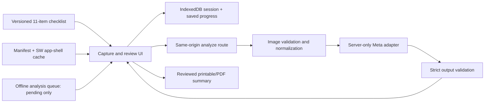

# Design — 11-item catalog + installable PWA (epoch 3)

Epochs 1–2 architecture is retained and extended. All existing modules are reused unchanged (see reuse table in 03-plan); only the catalog data, PWA shell, offline queue states, and PDF acceptance are new.

## Reused paths

| Path | Responsibility (unchanged) |
|---|---|
| src/app/ | Shell, routes, layout (walkthrough.css adopted) |
| src/features/walkthrough/ | Capture, review, summary, session manager |
| src/domain/ | Catalog/evidence schemas, reducer, review rules |
| src/data/catalog.demo.json | Catalog data file (v0.2.x, 11 items; unconfirmed wording labeled OPEN) |
| src/storage/ | IndexedDB versioning/deletion (saved progress rides on it) |
| src/server/meta/ | Provider adapter/config/validation/timeout |
| src/server/media/ | Decode limits and normalization |
| src/export/ | Safe printable summary (+ PDF acceptance via print CSS) |
| fixtures/ | Rights-cleared media and response fixtures (11-item coverage) |
| tests/unit/, tests/e2e/ | Boundary/state/API/browser tests (extended, not rewritten) |

## New paths

| Path | Responsibility |
|---|---|
| public/manifest.webmanifest | PWA manifest: name, icons, display standalone, theme (REQ-013) |
| public/icons/* | Install icons (maskable + any, rights-cleared) |
| public/sw.js | Service worker: app-shell precache + offline fallback; caches shell/assets only, never evidence bytes, provider payloads, keys, or full-resolution media (REQ-007/013) |
| src/features/walkthrough/offline.ts | Offline queue: analysis intents stored as pending with attempt identity; explicit sync on reconnect; UI pending states (REQ-007) |

## Catalog v0.2 contract (attested existence, OPEN details)

`catalogId` stays `demo-habitability-walkthrough` until mapping details confirm; version is `0.2.x` (prerelease `0.2.0-demo.1` accepted; later `0.2.x` patches keep IDs). Exactly 11 items with stable `demo-*` IDs and capture guidance; every item requires `photoCannotEstablish=true` AND `requiresPhysicalTest=true`.

Confirmation uses the REQ-001 two-field model. The source-confirmation record reads `attested: true` (owner statement Oct 28, 2026) with `verifier: null`, `verifiedAt: null`, and all detail fields `OPEN`. The fail-closed gate keys on missing verifier/details — NOT on attested existence: validation rejects any operative mapping claim while `verifier`/detail fields are absent, even though the 11-item scope itself is attested. Display keeps the demo-checklist label on every surface until verifier + details confirm. This resolves the epoch-3 spec finding: attested existence and unconfirmed details coexist without contradiction, and TASK-071 implements exactly this gate.

## Offline and pending semantics

Connectivity loss never synthesizes a draft. Queued analyses show `pending` with the staged photo and item; worker may edit/cancel/delete while offline. On reconnect, each queued item requires explicit analysis action (button or explicit retry); attempt counters resume without collision with pre-offline attempts. `stillCurrent`/generation guards from epoch 2 cover reconnect races identically to replace/cancel races.

## PDF output

No new renderer: the existing print stylesheet produces the PDF via browser print-to-PDF. New work is acceptance only — PDF carries the identical banner, unresolved policy, escaping, and data-URL-only media as HTML (verified by export-snapshot tests plus one browser print-CSS pass).

## Trust boundaries (unchanged, PWA adds none)

Service worker must not cache POST /api/analyze, IndexedDB evidence, provider payloads, keys, or full-resolution media. Installability changes no server boundary (REQ-010 holds). Offline queue stores only staged capture bytes already held in memory/IDB, never new exfiltration paths.
